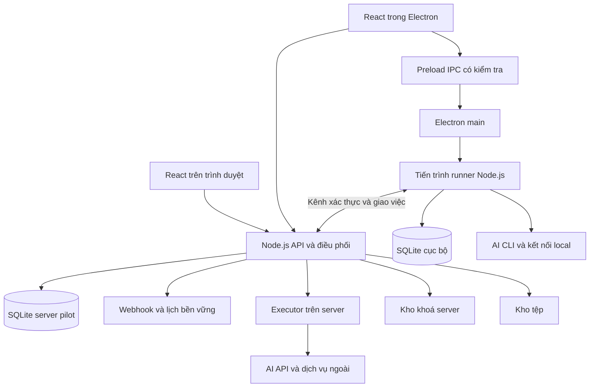

# Kế hoạch triển khai WINMATE với Electron Node.js React và SQLite

Ngày nghiên cứu: 29/10/2026. Trạng thái: đề xuất kiến trúc và kế hoạch triển khai để review; chưa bắt đầu xây sản phẩm.

**Mục tiêu:** triển khai WINMATE theo đặc tả v1.3, giữ bộ công nghệ Electron + Node.js + React + SQLite, ưu tiên chứng minh luồng chạy thật và phục hồi trước khi hoàn thiện toàn bộ màn hình.

**Kiến trúc đề xuất:** Electron là ứng dụng desktop; React dùng chung phần giao diện web/desktop; Node.js đảm nhiệm API, điều phối và runtime; SQLite cục bộ cho từng máy. Pilot có thể dùng thêm SQLite trên một server Node.js riêng, với điều kiện kiểm chứng tải và phục hồi; PostgreSQL là phương án thay thế dữ liệu server khi cần mở rộng.

**Hướng dẫn thực hiện:** làm theo các gói việc và cổng nghiệm thu dưới đây. Tách thành kế hoạch kỹ thuật nhỏ trước mỗi gói; thực hiện tuần tự trong phiên làm việc, không tự commit/push hoặc thay đổi backlog trên Drive. Mọi mã nguồn và tài liệu ghi bằng UTF-8.

## 1. Kết luận nghiên cứu

Bộ công nghệ được nêu có thể làm nền cho WINMATE. Điều cần bổ sung là phân định rõ desktop, server và dữ liệu; Electron + một file SQLite trên máy người dùng không thể đáp ứng việc vẫn nhận webhook và giữ lịch khi máy đó đã tắt.

| Thành phần | Vai trò đề xuất | Ranh giới cần giữ |
| --- | --- | --- |
| Electron | Cửa sổ app, preload IPC, tích hợp hệ điều hành, ghép máy, khởi động runner, quản lý phiên CLI trên máy | Giao diện không có quyền Node.js trực tiếp; main process không thực thi workflow dài |
| React + TypeScript | Màn 1A–8D, canvas, form, lịch sử, chat; dùng chung phần tính năng cho web/desktop | Không trực tiếp đọc SQLite, giải mã key hoặc chạy lệnh |
| Node.js + TypeScript | API server, webhook, lịch, quyền, quota, hàng đợi, executor, adapter tích hợp | Logic nghiệp vụ không phụ thuộc Electron hay component React |
| SQLite trên Desktop | Checkpoint cục bộ, sự kiện chưa gửi, cache được cấp quyền, metadata tệp, tuỳ chọn máy | Không là nguồn chuẩn của thành viên, quyền, ví hoặc lịch toàn công ty |
| SQLite trên server pilot | Dữ liệu chuẩn và hàng đợi bền vững trên một máy chủ | Không chia sẻ file DB qua mạng; không triển khai nhiều bản ghi đồng thời trên nhiều host |

Electron có mô hình main/renderer và cho phép tách công việc sang tiến trình phụ; đây là cơ sở cho việc giữ UI độc lập với runner. [Tài liệu Electron](https://www.electronjs.org/docs/latest/tutorial/process-model).

SQLite hỗ trợ một writer tại một thời điểm trên mỗi file; WAL cho phép đọc và ghi đồng thời nhưng yêu cầu các tiến trình truy cập ở cùng host. Vì vậy đề xuất dùng API làm cửa vào dữ liệu server, không mở file SQLite từ các desktop qua ổ mạng. [SQLite khi nào nên dùng](https://www.sqlite.org/whentouse.html), [SQLite WAL](https://www.sqlite.org/wal.html).

## 2. Tài liệu đã đối chiếu và phát hiện mới

### 2.1 Nguồn nghiệp vụ

- `WINMATE-chuc-nang-v1.3.docx`: nguồn ưu tiên; quyết định mới hơn ghi trong tài liệu thay quyết định cũ.
- `WINMATE_Prototype_Final_v25.18.html`: tham chiếu giao diện; giới hạn prototype được ghi ở phụ lục B. Chưa khảo sát trực tiếp từng màn bằng trình duyệt trong lần lập kế hoạch này.
- `TOM-TAT-HIEU-DU-AN-WINMATE.md`: bản tổng quan đã tạo trước đó.
- [Backlog v1.1 trên Drive](https://docs.google.com/spreadsheets/d/1NjIxAmJhg6U2waNmtCwDW9Acn29loX0t/edit): đã tải bản XLSM vào thư mục tạm, đọc các sheet và đối chiếu danh sách story. Không chạy macro và không sửa file trên Drive.

### 2.2 Backlog hiện tại dùng kiến trúc khác

Workbook có 6 sheet: Tổng hợp, Stories, Tasks, AC, Quy ước và Coverage. Đã đếm lại sheet Stories: **204 story, 918 SP, 1.836 giờ baseline**; tổng hợp ghi **1.020 task**, dự phòng 15%, tổng **2.111,4 giờ**, tương đương khoảng **13,20 người-tháng** theo quy ước 160 giờ.

Đây là số liệu của workbook, không phải cam kết giao hàng hoặc kết quả ước lượng mới. Bảng lấy 1 SP = 2 giờ và sinh 5 task/story; ví dụ task của story khởi tạo monorepo vẫn có công việc API/form. Cần viết lại task theo đầu ra thực tế, không mặc nhiên coi mọi task đó đã đủ chính xác để triển khai.

Workbook nhắc tài liệu “Kiến trúc v2.0” nhưng tài liệu đó không có trong thư mục hiện tại. Các story kỹ thuật chứa Java, Temporal, PostgreSQL RLS và GCP. Lựa chọn Node.js + SQLite làm thay đổi thiết kế lẫn khối lượng; không đổi tên thư viện rồi giữ nguyên ước lượng.

| Story cũ | Cách xử lý trong kế hoạch mới |
| --- | --- |
| WM-ST-001 | Monorepo TypeScript cho web, Electron, server và các package dùng chung; bỏ contract Java–TS |
| WM-ST-004 | SQLite không có PostgreSQL RLS; bổ sung tenant-scoped repository, ràng buộc và test xuyên tenant; nếu chọn PostgreSQL server thì đánh giá lại RLS |
| WM-ST-010 | Chọn môi trường triển khai theo yêu cầu vận hành, không tự xem GCP là bắt buộc |
| WM-ST-014 | Thay tích hợp Temporal/Java bằng bộ điều phối Node.js bền vững trong phương án pilot; tự chịu trách nhiệm timer, resume, lease và phục hồi |
| WM-ST-015 | Contract TypeScript/runtime schema giữa server và runner, không còn Java–Node |
| WM-ST-020, 024, 030 | Chốt checkpoint, effect ledger và đối soát; không tự retry nghiệp vụ trái Q04 |
| WM-ST-032 | Kiểm chứng Windows trước, giữ thiết kế đa nền tảng; cần xác nhận ưu tiên macOS trước khi lập lịch phát hành |
| WM-ST-198 | Thử phục hồi runtime Node.js, thay test replay đặc thù Temporal |
| WM-ST-200 | Mục tiêu 100 công ty/10.000 người dùng là backlog kỹ thuật cần xác nhận; không coi SQLite pilot đã đạt mục tiêu này |
| WM-ST-204 | Viết lại ADR theo stack mới, ghi rõ điều kiện giữ/thay SQLite trên server |

## 3. Ba cách triển khai và lựa chọn đề xuất

| Phương án | Điểm mạnh | Đánh đổi | Kết luận |
| --- | --- | --- | --- |
| A. Chỉ Electron + SQLite local | Ít hạ tầng, nhanh làm công cụ cá nhân | Thiếu nơi nhận webhook, lịch, duyệt và hàng chờ khi máy tắt; khó quản lý nhiều người | Chỉ phù hợp bản thử local bị giảm phạm vi |
| B. Desktop + Node.js server + SQLite local và server riêng | Giữ stack, cùng ngôn ngữ, đủ mô hình desktop/server cho pilot | Phải tự xây điều phối bền vững; một host dữ liệu server; cần đo tải và diễn tập khôi phục | Đề xuất cho pilot có giới hạn đã công bố |
| C. Desktop SQLite + Node.js server + PostgreSQL | Thuận lợi hơn cho dữ liệu nhiều tenant và nhiều tiến trình server | Thêm thành phần vận hành; cần đổi schema/migration và lập lại estimate | Đề xuất khi mục tiêu mở rộng của backlog là yêu cầu phát hành đầu |

Kế hoạch dưới đây dùng B làm baseline nghiên cứu. Giai đoạn kiểm chứng đầu tiên quyết định tiếp tục SQLite server hay chuyển C; SQLite desktop vẫn giữ nguyên. Không gọi B là kiến trúc đã được nghiệm thu cho tải lớn.

## 4. Kiến trúc và luồng dữ liệu



### 4.1 Electron và React

- Main quản lý cửa sổ, vòng đời, ghép máy và các tác vụ hệ điều hành. Runner là tiến trình riêng; lỗi executor không được làm đứng cửa sổ hoặc mất checkpoint.
- Preload chỉ công bố hàm cụ thể như chọn thư mục, đọc trạng thái máy, gửi yêu cầu runner; không công bố nguyên `ipcRenderer`, SQL hay hàm chạy shell.
- Cấu hình bảo vệ gồm `nodeIntegration: false`, `contextIsolation: true`, renderer sandbox, CSP, kiểm tra sender và payload IPC, giới hạn navigation/openExternal. Đây là các hướng dẫn chính thức của [Electron Security](https://www.electronjs.org/docs/latest/tutorial/security).
- Dùng chung React feature và contracts giữa web/desktop qua transport interface; tính năng CLI và file local phụ thuộc capability desktop. Quản lý state canvas riêng với state lấy từ server.
- React Flow là ứng viên canvas; thư viện hỗ trợ node editor và giấy phép MIT. Workflow engine, validation nghiệp vụ, nhánh và checkpoint vẫn cần tự xây. [React Flow](https://reactflow.dev/).

### 4.2 Server Node.js

Khởi đầu bằng ứng dụng server chia module rõ trách nhiệm, không chia microservice sớm. API, scheduler, dispatcher và server executor có thể cùng gói triển khai nhưng tách mã và vòng đời xử lý.

Server chịu trách nhiệm đăng nhập, company/tenant, quyền, dữ liệu chuẩn, webhook inbox, lịch, quota, phiên bản, run/step, duyệt, thông báo, ví và file metadata. Fastify là framework API được đề xuất vì có cơ chế plugin và validation; lựa chọn này là quyết định thiết kế, không phải yêu cầu đã có trong đặc tả. [Fastify](https://fastify.dev/docs/latest/).

Desktop chủ động nối ra server qua HTTPS và kênh realtime, không cần mở cổng inbound trên máy người dùng. Các yêu cầu giao việc có ID, lease, thời hạn, phiên bản và scope; lệnh trùng hoặc lease cũ không được chạy lần hai. Server là nơi chuẩn quyết định lượt nào được chạy.

### 4.3 Dữ liệu cục bộ và đồng bộ

- Server là nguồn chuẩn cho quyền, thành viên, trợ lý, phiên bản, kết nối chia sẻ, run và gói.
- Local là nguồn chuẩn cho đường dẫn, key chỉ máy này và nhật ký thực thi chưa gửi; không đồng bộ raw database.
- Kết quả bước được ghi transaction vào local checkpoint và outbox trước khi thông báo server. Outbox có sequence ID; server xử lý lặp an toàn rồi ACK; desktop chỉ đánh dấu đã gửi sau ACK.
- Reconnect lấy snapshot/cursor mới và đối chiếu lease hiện hành. Không chạy tiếp chỉ vì local ghi “đang chạy” nếu server đã huỷ hoặc máy đã bị thu hồi.
- Không tự xây chế độ sửa offline rồi merge workflow trong pilot; khi mất server, cho xem cache có dấu thời điểm cập nhật. Quyền thực thi khi mất server phải được chốt ở mục 11 trước khi nghiệm thu.

### 4.4 Khoá và tệp

Desktop dùng cơ chế bảo vệ của hệ điều hành thông qua safeStorage và kiểm tra khả dụng; không đưa key lên renderer. Windows safeStorage bảo vệ theo ngữ cảnh người dùng, không phải hàng rào chống mọi chương trình chạy cùng tài khoản. Chọn API tương thích với Electron đã pin vì tài liệu hiện hành có thay đổi giữa API đồng bộ và bất đồng bộ. [Electron safeStorage](https://www.electronjs.org/docs/latest/api/safe-storage).

Kho khoá server là thành phần riêng: ciphertext và tham chiếu trong DB, master key từ nơi quản lý khoá của môi trường triển khai; không hardcode hoặc đặt master key cạnh bản sao DB. SQLite không tự mã hoá toàn bộ file. Đăng nhập CLI dùng luồng nhà cung cấp; WINMATE không đọc/copy credential CLI để chia sẻ.

Tệp lớn lưu qua storage adapter; SQLite giữ metadata/quyền, không lưu mặc định mọi tệp vào BLOB. Đường dẫn local phải kiểm tra canonical path, junction/symlink và thư mục cho phép; không gửi tham chiếu đường dẫn local cho server rồi coi server đọc được tệp.

## 5. Thiết kế runtime cần chốt trước UI đầy đủ

### 5.1 Workflow và phiên bản

Workflow có schema version, node ID bất biến, cạnh/nhánh và cấu hình từng loại node. Lưu bản nháp bằng revision để phát hiện sửa đồng thời. Kích hoạt tạo phiên bản immutable sau validation. Run giữ snapshot phiên bản lúc tạo; sửa hoặc tắt trợ lý không đổi phiên bản của lượt chờ đã có.

Validator phải kiểm tra: đúng một trigger; tham chiếu biến hợp lệ theo thứ tự/phạm vi nhánh; kết nối khả dụng và đúng nơi chạy; quyền sử dụng; cấu hình node; con được gọi có thể chạy; vòng gọi chỉ theo cấu hình; nhánh tối đa 10; vòng quay lại tối đa 1–10; chờ thời gian tối đa 30 ngày. Không dùng `eval` để tính điều kiện hoặc biến.

### 5.2 Trạng thái và điều phối

Run dùng các trạng thái `queued`, `running`, `waiting_approval`, `waiting_timer`, `waiting_desktop`, `succeeded`, `failed`, `cancelled`; lý do lỗi và mốc máy tắt lưu riêng để render đúng nhãn nghiệp vụ. Step bổ sung trạng thái nội bộ `effect_uncertain` khi chưa biết thao tác ngoài đã thành công hay chưa; cách hiển thị cần chốt với nghiệp vụ.

Mỗi trợ lý chỉ giữ một lượt thực thi chủ động; lượt chờ duyệt/timer nhường chỗ cho lượt sau. Khi lượt chờ sẵn sàng trở lại, việc nhập lại hàng đợi phải có thứ tự được chốt. Máy có thêm giới hạn số trợ lý khác nhau đang chạy. Timer và lịch lưu bằng UTC kèm timezone cấu hình, không chỉ giữ trong `setTimeout` của tiến trình.

Job claim bằng transaction có điều kiện, cấp lease và số thế hệ giao việc. ACK cũ không được ghi đè lần giao mới. Transaction ngắn; không giữ khoá DB trong lúc gọi mạng, AI hoặc chờ người duyệt. Lượt có thể được giao lặp trên đường truyền, nhưng phải có bản ghi chống lặp trước khi chạy tác vụ.

### 5.3 Không ghi trùng và phục hồi

1. Tạo `step_execution_id` và `effect_id` ổn định cho từng lần thực thi thực tế, phân biệt lần lặp node và lần chạy lại có chủ đích.
2. Ghi ý định thực thi trước khi gửi thao tác ghi; truyền idempotency key nếu dịch vụ đích hỗ trợ.
3. Lưu kết quả và external ID rồi mới đánh dấu hoàn thành; khi phục hồi bỏ qua bước đã hoàn thành.
4. Nếu mất kết nối sau khi gửi nhưng chưa lưu kết quả, đối soát qua idempotency key hoặc external lookup.
5. Nếu không thể đối soát, dừng ở trạng thái cần kiểm tra, không tự gửi lại. Đề nghị đây là cách triển khai cho trường hợp tài liệu nói “chạy tiếp từ bước dang dở”; cần xác nhận vì đặc tả chưa giải quyết đầy đủ cửa sổ mất ACK này.

Không hứa “exactly once” với mọi API ngoài. Q04 cấm tự thử lại lỗi nghiệp vụ; retry truyền sự kiện/ACK an toàn phải được tách khỏi retry thao tác nghiệp vụ. Chạy lại bằng tay tạo lịch sử rõ và hỏi xác nhận nếu đã có bước ghi thành công.

### 5.4 Máy tắt và mất mạng

Heartbeat đề xuất mỗi 30 giây; ngưỡng mất tín hiệu theo đặc tả là hơn 2 phút. Mất tín hiệu chỉ chứng minh không liên lạc được, chưa chứng minh tiến trình cũ đã dừng. Vì vậy cần lease/fencing và chính sách tạm dừng tác vụ mới khi không kiểm tra được quyền; không tự chuyển máy/server/API.

Webhook trả 202 khi đã ghi bền vững dữ liệu và tạo lượt chờ máy; không trả “đã nhận” rồi mới lưu. Giữ 24 giờ/3 ngày/7 ngày, hết hạn ghi lý do và thông báo; khi trở lại giữ nguyên run ID, snapshot và các bước đã hoàn thành. Sự kiện/nhắc lỗi cần gộp theo đặc tả tối đa một tin mỗi 30 phút mỗi trợ lý trong một lần gián đoạn.

### 5.5 Quyền tại thời điểm chạy

Quyền kiểm tra tại API, admission và trước từng bước dùng kết nối; không chỉ ẩn nút UI. Lượt tự động dùng quyền người sở hữu; chạy tay còn phải kiểm tra quyền người yêu cầu theo đặc tả. Quyền riêng ưu tiên, nhiều nhóm lấy mức cao nhất, scope không vượt scope kết nối.

Đặc tả có cả nguyên tắc thay quyền cho lượt mới và quy tắc riêng thu hồi quyền kết nối chặn từ bước tiếp theo. Đề xuất áp dụng quy tắc riêng của kết nối tại ranh giới bước; không sửa kết quả bước đã xong. Trường hợp mất server không thể biết thu hồi quyền cần chốt chính sách riêng.

Ba cơ chế xác nhận phải tách dữ liệu: chạy thử hỏi từng bước ghi; cho phép cặp trợ lý × hành động ghi lần đầu theo R12; duyệt nội dung từng lượt bằng node Chờ người duyệt. R12 gửi người tạo trợ lý, không được thay bằng người sở hữu mà không có quyết định.

## 6. Lựa chọn thư viện và rủi ro đóng gói

| Hạng mục | Đề xuất ban đầu | Kiểm chứng trước khi pin |
| --- | --- | --- |
| Ngôn ngữ | TypeScript strict toàn bộ app/runtime | Schema runtime cho tất cả dữ liệu qua IPC/API; TypeScript không thay thế validation |
| API | Fastify | Plugin auth, schema, error contract, streaming và khả năng test |
| Canvas | `@xyflow/react` | Layout nhánh, loop, thao tác trong nhánh, ID và serialisation |
| SQLite | Repository interface + migration SQL; ứng viên driver `better-sqlite3` | Native build đúng Electron/OS/arch; truy vấn nặng đặt trong tiến trình dữ liệu riêng |
| Driver thay thế | `node:sqlite` nếu runtime Electron được chọn thực sự hỗ trợ đủ | Không suy ra từ Node.js cài trên máy; kiểm tra Node nhúng trong Electron và mức ổn định API |
| Đóng gói | Electron Forge, kiểm chứng template/bundler trong G0 | Installer Windows, native driver, signature, update/rollback |
| Kiểm thử | Unit/integration cho domain, DB, API; Playwright cho web và Electron smoke | Electron automation của Playwright hiện được đánh dấu experimental; bổ sung thử bộ cài trên máy sạch |

Electron có ABI riêng cho native module, cần rebuild theo phiên bản Electron và kiểm tra sau nâng cấp. [Native Node Modules](https://www.electronjs.org/docs/latest/tutorial/using-native-node-modules). `node:sqlite` trong tài liệu Node.js hiện hành được ghi release candidate; chưa lấy đó làm lý do mặc định chọn trong Electron. [Node SQLite](https://nodejs.org/api/sqlite.html).

Forge có template Vite nhưng tài liệu vẫn ghi hỗ trợ experimental; kiểm chứng trước khi chọn thay vì coi cấu hình mặc định là ổn định cho mọi bản nâng cấp. [Forge Vite](https://www.electronforge.io/templates/vite). Tương tự, [Playwright Electron](https://playwright.dev/docs/api/class-electron) cần được xem là một lớp kiểm thử bổ sung.

Không pin số phiên bản bằng trí nhớ trong bản plan. G0 ghi ADR compatibility gồm Electron/Node nhúng/React/driver/OS/architecture, lockfile và kết quả build installer thật; server dùng Node LTS tương thích đã kiểm chứng.

### AI và CLI

Codex có chế độ non-interactive và output sự kiện JSON; App Server là lựa chọn để tích hợp sâu hơn. Đề xuất thử `exec` cho workflow một bước, đánh giá App Server cho chat/resume; không trộn cơ chế phiên giữa các user. [Codex non-interactive](https://learn.chatgpt.com/docs/non-interactive-mode), [Codex App Server](https://learn.chatgpt.com/docs/app-server).

Claude Code hỗ trợ chạy bằng `-p` và output có cấu trúc. Khả năng dùng gói tháng phải kiểm chứng bằng đúng cách đăng nhập và tài khoản được phép; thông tin quota/gói không hardcode. [Claude Code programmatic](https://code.claude.com/docs/en/headless), [Claude plan và Agent SDK](https://support.claude.com/en/articles/15036540-use-the-claude-agent-sdk-with-your-claude-plan).

Phát hiện executable và trạng thái qua giao diện được hỗ trợ; không tự cài CLI khi tài liệu quy định người dùng tự cài. Tạo process bằng executable + danh sách tham số, ưu tiên `shell: false`, không ghép prompt thành chuỗi shell; `.cmd/.bat` trên Windows cần wrapper được kiểm soát hoặc executable thật và test riêng. [Node child process](https://nodejs.org/api/child_process.html).

## 7. Cấu trúc mã nguồn đề xuất

Đây là các đường dẫn dự kiến, chưa có mã nguồn tương ứng. Mỗi package có public API riêng; test đặt cạnh module hoặc trong `tests` theo cấu trúc dưới.

```text
apps/
  desktop/src/main/           cửa sổ, IPC handlers, bảo vệ OS
  desktop/src/preload/        bridge giới hạn cho renderer
  desktop/src/runner/         bootstrap runner và local transport
  desktop/src/storage/        migration SQLite cục bộ và outbox
  web/src/                   bootstrap React web
  server/src/modules/        identity, assistants, runs, connections, billing
  server/src/scheduler/       lịch, durable timer, hạn chờ
  server/src/dispatcher/      claim, lease, ACK, giao việc desktop/server
  server/src/storage/         schema, migrations, SQLite repositories
packages/
  contracts/src/              workflow, IPC, API, runner message schemas
  domain/src/                 quyền, quota, trạng thái, quy tắc thuần
  workflow-engine/src/        validator, interpreter, context, checkpoint
  executors/src/              HTTP, AI, CLI, MCP, approval, subworkflow
  ui/src/features/            chat, assistants, builder, history, connections
  ui/src/components/          component nhỏ dùng chung, form, dialog
  transport/src/             HTTP/realtime và desktop capability interfaces
tests/
  contracts/                 tương thích schema và version
  integration/               DB, scheduler, runner, policy
  e2e/                       luồng web/desktop
  failure/                   crash, lost ACK, reconnect, disk full
docs/
  adr/                       quyết định kiến trúc và compatibility
  requirements/              coverage đặc tả và bảng đổi backlog
  runbooks/                  cài đặt, backup, phục hồi, update
```

Core/domain không import React, Electron, Fastify hay driver SQLite. Executor phụ thuộc interface cho network, credential, effect ledger, clock và event sink; nhờ đó thử lỗi mà không gọi AI hoặc tạo đơn thật.

## 8. Kế hoạch theo cổng nghiệm thu

Ưu tiên P0 dưới đây là thứ tự kỹ thuật đề xuất, không đổi cột ưu tiên trên workbook. Mỗi gói cần kiểm tra hồi quy liên quan trước khi coi hoàn thành. Test quyền, phục hồi và chống ghi trùng bắt đầu từ đầu, dù workbook xếp nhiều story QA vào P2.

### G0 — Kiểm chứng công nghệ và điều chỉnh backlog

**Phụ thuộc:** tài liệu hiện có; máy Windows thử nghiệm; tài khoản thử AI khi đến phần gọi thật. **Ngân sách thăm dò:** 64–104 giờ công, là đề xuất dự trù chưa đo, không cộng mặc nhiên vào baseline cũ.

- [ ] **T01 · Ma trận yêu cầu và đổi kiến trúc — 8–12 giờ.** Tạo `docs/requirements/coverage-v1.3.md`, `docs/requirements/backlog-stack-delta.md`, `docs/adr/0001-runtime-boundaries.md`. Gắn từng màn, 17 node và R01–R14 vào module/test; đánh dấu thay đổi Java/Temporal/RLS. Hoàn thành khi mỗi yêu cầu có chỗ triển khai hoặc quyết định phạm vi rõ.
- [ ] **T02 · Thử Electron và SQLite đóng gói — 12–20 giờ.** Tạo thử tối thiểu ở `experiments/desktop-packaging/`, migration thử và `docs/adr/0002-runtime-compatibility.md`. Build installer, cài trên Windows sạch, ghi/đọc DB, đóng/mở, restart runner, kiểm tra Unicode và đường dẫn có dấu. Hoàn thành khi bản cài chạy được ngoài môi trường dev.
- [ ] **T03 · Chứng minh mất ACK và phục hồi — 16–24 giờ.** Thử ở `experiments/durable-runner/` với một HTTP server giả ghi nhận effect ID. Tiêm crash trước gửi, sau gửi, trước checkpoint và trước ACK. Hoàn thành khi bước đã xong không chạy lại, side effect chưa rõ được giữ để đối soát, không báo thành công giả.
- [ ] **T04 · Đo SQLite server — 12–20 giờ.** Tạo `experiments/sqlite-load/` và báo cáo `docs/adr/0003-server-database.md`. Đo webhook, run/step/event ghi đồng thời, đọc lịch sử, checkpoint, restart và backup. Ghi phần cứng, payload, concurrency, p95/p99, SQLITE_BUSY và tốc độ WAL. Hoàn thành khi quyết định có bằng chứng giữ B hoặc chuyển C.
- [ ] **T05 · Kiểm chứng AI CLI/API — 16–28 giờ.** Thử ở `experiments/ai-adapters/` và `docs/adr/0004-ai-integration.md`. Kiểm tra executable, đăng nhập chính thức, JSON stream, huỷ, quota, resume, model/effort và scope công cụ; ghi capability thực sự hỗ trợ. Nếu chưa có tài khoản thì adapter giả phục vụ test được, nhưng gate tích hợp thật vẫn chưa đạt.

**Qua G0:** có quyết định database server, runtime compatibility, chính sách side effect chưa rõ và phương án AI được chứng minh. Không xây trọn UI trước khi biết các gate này có qua hay không.

### G1 — Nền tảng và một luồng chạy thật

**Phụ thuộc:** G0. **Đầu ra demo:** đăng nhập → tạo kết nối HTTP đọc → tạo trợ lý → chạy tay trên desktop → xem kết quả cùng run ID trên web.

- [ ] **T06 · Khung ứng dụng và contracts.** Tạo apps và packages theo mục 7, schema trong `packages/contracts/src/{workflow,runner,api,ipc}.ts`; CI typecheck/lint/test/build. Test: payload sai bị từ chối ở cả IPC và API; renderer không đọc file/chạy process ngoài bridge.
- [ ] **T07 · Identity, tenant, quyền tối thiểu.** Tạo `apps/server/src/modules/identity/`, `packages/domain/src/permissions/`, migration tenant/member/role/group/audit. Test: tenant A không xem được ID tenant B qua API, realtime hay job; quyền riêng chặn quyền nhóm; không tự nâng quyền. Dùng fixture ít nhất hai công ty.
- [ ] **T08 · Assistants, draft và publish.** Tạo `apps/server/src/modules/assistants/`, `packages/workflow-engine/src/validate.ts`; DB assistant/version/node. Test: publish tạo snapshot; sửa draft không đổi run cũ; revision conflict không ghi đè âm thầm; thiếu connection/nơi chạy sai không kích hoạt.
- [ ] **T09 · Runtime cơ bản và HTTP executor.** Tạo `packages/workflow-engine/src/{interpreter,context}.ts`, `packages/executors/src/http/`, `apps/server/src/modules/runs/`. Test trigger → HTTP đọc → output; timeout dừng; endpoint ngoài danh mục bị chặn; chạy thử ghi phải xác nhận; tenant/scope được kiểm trước side effect.
- [ ] **T10 · Ghép máy và giao việc.** Tạo `apps/server/src/dispatcher/`, `apps/desktop/src/runner/`, local outbox/checkpoint. Test ghép máy hết hạn 10 phút, heartbeat, ACK trùng, lease cũ, disconnect/reconnect; hai dispatcher không chiếm cùng lượt; máy bị thu hồi không nhận việc mới.
- [ ] **T11 · UI dùng được cho luồng đầu.** Tạo `packages/ui/src/features/{assistants,history,connections}/`; React web và Electron dùng cùng API. Test từ UI tạo/chạy/xem lịch sử; loading/empty/error; refresh giữ dữ liệu; ID link mở đúng lượt; không dùng dữ liệu demo làm kết quả thực thi.

### G2 — Runtime bền vững và vận hành tự động

**Phụ thuộc:** G1. **Đầu ra demo:** webhook/lịch khi máy tắt được giữ; mở lại máy tiếp tục đúng lượt và đúng phiên bản.

- [ ] **T12 · Webhook, lịch và durable inbox.** Tạo `apps/server/src/modules/webhooks/`, `apps/server/src/scheduler/`; inbox, trigger và schedule occurrence unique. Test 401 không tạo lượt, lọc không đạt 200 bỏ qua, trợ lý tắt 409 theo đặc tả, máy tắt 202 sau durable commit; một webhook xét riêng hai trợ lý; nghe thử không tạo run; timezone và lịch bị lỡ.
- [ ] **T13 · Queue, máy tắt và expiry.** Bổ sung lease/outbox event, queue query và offline-event history. Test 100 lượt cùng trợ lý chạy tuần tự; node chờ nhường slot; hạn 24h/3d/7d; huỷ lượt chờ; người dùng tắt trợ lý nhưng lượt chờ cũ vẫn theo snapshot; gộp thông báo đúng quy tắc.
- [ ] **T14 · Duyệt và timer.** Tạo `packages/executors/src/{approval,timer}/`, `apps/server/src/modules/approvals/`. Test duyệt một người/tất cả/lần lượt/trưởng nhóm, callback lặp hoặc hết hạn, người chỉ có Xem nhưng được gán duyệt, nội dung đổi phải duyệt lại, restart server không mất timer, máy tắt vẫn nhận kết quả duyệt.
- [ ] **T15 · Nhánh, vòng lặp và trợ lý con.** Tạo `packages/workflow-engine/src/control-flow/`, `packages/executors/src/subworkflow/`. Test biến nhánh không chạy báo lỗi, tối đa 10 nhánh, lặp quay lại dùng output mới, lặp danh sách có concurrency, run con giữ nơi chạy riêng, con tắt chặn, huỷ cha huỷ con, chạy thử truyền xuống con.
- [ ] **T16 · Effect ledger và an toàn chạy lại.** Tạo `packages/domain/src/effects/`, ledger repository và màn đối soát lịch sử. Test cửa sổ crash T03 trên cả server/desktop, cấp lại lease khi worker cũ còn sống, bước ghi đã thành công không lặp, không retry lỗi thường, chạy lại có xác nhận và lineage rõ.

### G3 — AI, trình tạo và chat

**Phụ thuộc:** G2 và T05. **Đầu ra demo:** người dùng mô tả nhu cầu → AI tạo draft hợp lệ → xem/sửa/thử → kích hoạt theo quyền.

- [ ] **T17 · Bốn executor AI.** Tạo `packages/executors/src/ai/{claude-code,codex,claude-api,openai-api}/`; credential resolver theo nơi lưu key. Test key ở Kho khoá gọi server kể cả workflow desktop; key local gọi máy; không fallback; huỷ/hết quota/schema JSON sai hiển thị đúng; session không dùng chéo user.
- [ ] **T18 · Canvas 2C.** Tạo `packages/ui/src/features/builder/{canvas,node-panel,variables,validation}/`. Làm chèn/xoá/nhân bản/sắp xếp, nhánh/vòng lặp, đổi loại cùng nhóm, biến bước trước, autosave/revision, publish, thử bước/toàn lượt. Test thao tác trong nhánh và loop; node không có kết nối không được chèn; xoá node có tham chiếu cảnh báo và chặn publish khi lỗi.
- [ ] **T19 · Chat 1A–1B và builder AI.** Tạo `packages/ui/src/features/chat/`, `apps/server/src/modules/conversations/`, workflow patch service. AI chỉ đề xuất cấu hình/patch có schema; backend validate quyền và revision trước áp dụng. Test Sửa luôn/Hỏi trước/Hoàn tác, slash command, thiếu input, máy tắt hỏi xếp hàng, đính kèm và quyền file; Agent không tự xuất SQL hoặc bỏ qua duyệt.

### G4 — Hoàn thiện kết nối và quản trị doanh nghiệp

**Phụ thuộc:** các capability G1–G3 liên quan. **Đầu ra:** hoàn thiện chức năng 5A–5L, 6A và 8A–8D với tích hợp thật có tài khoản thử.

- [ ] **T20 · Kết nối đủ sáu nhóm và executor còn lại.** Tạo `packages/executors/src/{cli,mcp,lark,facebook,pancake,poscake}/`, connection wizard/detail và capability registry. Làm 9 mẫu, endpoint/tool allowlist, scope, kiểm tra kết nối, kiểm tra định kỳ, giới hạn gọi dùng chung, thay key phải kiểm tra, ngắt kết nối không tự tắt trợ lý. Test CLI không AI, MCP chọn đúng công cụ, local command chỉ Desktop, HTTP chặn SSRF/redirect sang mạng không cho phép, scope không nới bởi prompt; R12 nhớ đúng cặp và có thu hồi.
- [ ] **T21 · Thành viên/nhóm/vai trò đầy đủ.** Hoàn thiện `identity` và UI `members/`. Test nhiều nhóm, lời mời hết hạn 7 ngày không giữ chỗ, quản trị không sửa quản trị khác, khoá phải chuyển owner, mất quyền từ bước tiếp theo trên kết nối, scope cá nhân không vượt connection, ảnh hưởng N người được đếm không trùng.
- [ ] **T22 · Thư mục và file.** Tạo `apps/server/src/modules/files/`, storage adapter WINMATE/Lark/Google/local, UI `files/`. Test quyền Đọc/Ghi/Tải về độc lập, kế thừa, chuyển bằng ID, thùng rác 30 ngày, quota/warning 80%, file chat, canonical path local và đường dẫn có dấu. Thử provider thật riêng với tài khoản có scope phù hợp.

### G5 — Kho trợ lý, thương mại và phát hành

**Phụ thuộc:** G4 cho toàn bộ phạm vi phát hành.

- [ ] **T23 · Kho và cài mẫu 3A–3B.** Tạo module `catalog/`, UI `marketplace/` và installer workflow. Test wizard 7 bước, capability bắt buộc thiếu chặn, ghép field, người duyệt/máy, thử thật có xác nhận, hết suất cài Tắt, huỷ hỏi giữ/xoá nháp; cài thành bản độc lập không tự nhận update mẫu.
- [ ] **T24 · Gói, quota và ví 7A.** Tạo `apps/server/src/modules/billing/`, `packages/domain/src/entitlements/`, UI `billing/`. Admission và quota cơ bản đã dùng từ G1; tại đây hoàn thiện giá/gia hạn/thanh toán. Test hai yêu cầu bật cuối suất cạnh tranh chỉ một thành công; ledger tiền bằng số nguyên VND; callback thanh toán lặp không cộng hai lần; QR phải đối soát thực; prorate/giảm kỳ sau, 7d/1d nhắc, 3d ân hạn, chặn lượt mới và giữ lượt chờ sau ân hạn; gia hạn không tự bật mọi trợ lý.
- [ ] **T25 · Chất lượng, vận hành, bộ cài.** Hoàn thiện `tests/{contracts,integration,e2e,failure}/`, `docs/runbooks/`, build/release scripts. Test đủ 17 loại node, xuyên tenant, SSRF, IPC, không lộ key, backup/restore, disk full, restart server/desktop, upgrade DB và rollback binary tương thích. Smoke bộ cài ký số trên máy sạch; update không cắt ngang thao tác ghi; log có run/step/correlation ID và retention.

**Điều kiện phát hành:** các AC trong đặc tả có kết quả hoặc ngoại lệ phạm vi được ghi rõ; không dùng API giả/QR giả/chat demo thay chứng cứ tích hợp; không còn lỗi nghiêm trọng về mất dữ liệu, ghi trùng, lộ khoá, vượt quyền hoặc chạy sai nơi.

## 9. Ma trận bao phủ theo nhóm backlog

| Nhóm story | Gói chính | Chú ý |
| --- | --- | --- |
| 001–012 · Nền tảng | T01, T04, T06, T07, T25 | Kiến trúc đổi nên estimate lại |
| 013–031 · Core | T03, T08–T10, T12–T16, T24 | Không bỏ durable orchestration khi bỏ Temporal |
| 032–043 · Desktop | T02, T05, T06, T10, T17, T25 | Native packaging, phiên CLI, local key |
| 044–061 · Chat | T19 | Nháp, chạy thử, bật theo quyền/quota |
| 062–073 · Danh sách/tạo | T08, T11, T18 | Owner, runtime, clone/delete/history |
| 074–089 · Builder | T18, T19 | Nhánh, biến, revision và patch AI |
| 090–110 · Node | T09, T12, T14–T17, T20 | 17 node là loại; 21 story gồm biến thể/control policy |
| 111–121 · Kho | T23 | Capability phải khớp kết nối thật |
| 122–132 · Lịch sử | T11, T13, T16, T25 | Rerun, offline, export và retention |
| 133–155 · Kết nối | T05, T12, T17, T20 | R12, scope, đọc/ghi, nơi lưu key |
| 156–165 · Tệp | T22 | Bốn nơi lưu, quyền và quota |
| 166–176 · Gói/ví | T24 | Gate runtime phải có trước billing UI |
| 177–195 · Thành viên | T07, T21 | Ba lớp quyền và owner transfer |
| 196–204 · QA/release | T01–T05, T25 và test mỗi gói | QA chạy xuyên suốt, không đợi cuối |

Đây là mapping cấp nhóm. T01 phải tạo mapping từng AC trước khi coi coverage là đầy đủ.

## 10. SQLite server pilot cần những điều kiện gì?

1. Database trên local disk của host server; backup qua API/công cụ nhất quán, không copy tuỳ tiện file `.db` đang chạy rồi bỏ WAL.
2. Một thành phần quản lý ghi, transaction ngắn, foreign keys bật, index tenant/assistant/run/status/due_at, unique key cho schedule occurrence/idempotency/event ACK. Chọn WAL, synchronous và busy timeout bằng kiểm chứng durability; không hạ độ bền để làm đẹp benchmark.
3. Không giữ transaction qua lời gọi AI/mạng. Tách khối event/log lớn, phân trang lịch sử, theo dõi WAL và retention; không xoá job đang chờ theo chính sách log.
4. “Hàng đợi không giới hạn” theo nghiệp vụ được hiểu là không đặt quota số lượt trong gói; lưu trên đĩa, giám sát dung lượng. Dung lượng vật lý vẫn hữu hạn: khi không lưu bền vững được phải trả lỗi rõ, không ACK thành công giả và không âm thầm bỏ job.
5. Có diễn tập restore trên máy khác và kiểm tra khả năng giải mã khoá server, callback đã xử lý, ledger tiền, lượt đang chờ và quyền.
6. Chuyển PostgreSQL trước khi cần nhiều host ghi hoặc khi tải mục tiêu không đạt dù đã sửa truy vấn/index. Repository interface giảm việc sửa domain nhưng không làm migration dữ liệu/SQL trở nên tự động.

**Ngưỡng thử tải đề xuất, chưa phải SLA:** bắt đầu 10 công ty × 5 user đồng thời, burst 100 webhook vào một trợ lý, backlog 10.000 lượt, 100.000 event lịch sử; không mất dữ liệu/ghi trùng, không SQLITE_BUSY chưa xử lý. Đo API quản trị p95 dưới 500 ms và webhook durable ACK p95 dưới 1 giây trên máy thử được ghi cấu hình. Chỉ tăng tới 100 công ty/10.000 user nếu đó được chốt là mục tiêu, với profile hoạt động cụ thể; số user đăng ký không bằng số user đồng thời.

## 11. Quyết định còn thiếu và cách xử lý trong kế hoạch

Không dừng việc nghiên cứu vì các điểm này; chúng có owner và cổng cần giải quyết, không được tự coi là đã có yêu cầu chốt.

| Mã | Quyết định | Đề xuất làm việc | Hạn cần chốt |
| --- | --- | --- | --- |
| D01 | SQLite là bắt buộc cả server hay chỉ desktop? | SQLite desktop; server pilot có điều kiện G0; dùng C nếu cần mở rộng ngay | G0/T04 |
| D02 | Windows/macOS và quy mô phát hành đầu | Kiểm chứng Windows trước; chưa hứa ngày macOS hoặc tải 10.000 user | Trước lập lịch G1 |
| D03 | Thao tác ngoài chưa biết đã ghi hay chưa | Đối soát; nếu không chứng minh được thì chờ xử lý, không tự gửi lại | G0/T03 |
| D04 | Quyền khi mất server nhưng app còn sống | Đề xuất không khởi chạy bước ngoài mới khi không xác thực được quyền; đối soát tác vụ đang gửi | Trước G2 |
| D05 | Lượt sau bước chờ nhập lại queue theo thứ tự nào? | Dùng thời điểm sẵn sàng trở lại; giữ thứ tự phát sinh cho hàng chờ máy tắt theo đặc tả | Trước T13 |
| D06 | Thu hồi quyền giữa lượt | Quyền kết nối kiểm trước bước tiếp theo theo quy tắc riêng; giữ snapshot workflow | Trước T07/T16 |
| D07 | Nhà cung cấp thanh toán, email, lưu tệp, thông báo | Chọn provider thực và tài khoản thử; adapter giả chỉ cho test | Trước T14/T22/T24 |
| D08 | Người tạo đã bị khoá nhưng R12 cần hỏi người tạo | Cần quy tắc chuyển xử lý; không tự thay creator bằng owner trong code | Trước T20 |
| D09 | Quy tắc phản hồi webhook dùng chung nhiều trợ lý có kết quả khác nhau | Lưu kết quả riêng từng trợ lý, chốt HTTP response chung cho request | Trước T12 |
| D10 | Mâu thuẫn CLI trên server | Bảng node chung có Lark/Facebook CLI ở server, nhưng phần Kết nối và quy tắc nơi chạy ghi chỉ Desktop; đề xuất theo quy tắc chi tiết chỉ Desktop | G0/T01 |

## 12. Cách lập lịch và kiểm tra kết quả

Không chia 2.111,4 giờ cũ cho số lập trình viên rồi xem đó là ngày giao. Bảng cũ khác kiến trúc, task phân bổ theo công thức và chưa có dữ liệu velocity thực.

Thứ tự triển khai đề xuất: **G0 → G1 → G2 → G3 → G4 → G5**. Phần quyền, quota, ghi nhật ký và test sự cố được xây cùng nền tảng; kho mẫu và thanh toán đầy đủ triển khai sau luồng chạy thật. Sau G0 và một chu kỳ G1, đo giờ thực và estimate lại từng gói còn lại, tách công lập trình/QA/DevOps/tài khoản thử/ngày chờ provider. Có thể tổ chức đội theo UI, runtime/server và integration/QA khi đã chốt contracts; kế hoạch này không tự phân công người hoặc tạo chat mới.

Các lệnh kiểm tra dự kiến cần được tạo trong T06, **chưa phải lệnh đã chạy thành công ở workspace hiện tại**:

```text
npm run typecheck
npm run lint
npm run test:unit
npm run test:integration
npm run test:contracts
npm run test:failure
npm run test:e2e:web
npm run test:e2e:desktop
npm run build
npm run make:desktop
```

Từng lần báo hoàn thành phải ghi tổng số test pass/fail/skipped, phiên bản app/runtime, môi trường và file báo cáo. Test giả dùng cho logic lỗi; các tích hợp AI/CLI/thanh toán cần chứng cứ thử thật có tài khoản phù hợp. Bản plan hiện tại chỉ được kiểm tra nội dung, nguồn và UTF-8; chưa có mã sản phẩm để build/test.

**Việc bắt đầu cụ thể:** T01 lập coverage và sửa task lệch stack; T02 kiểm chứng bộ cài Electron/SQLite; T03 mô phỏng crash/mất ACK; T04 đo SQLite server; T05 kiểm chứng AI. Sau năm việc này mới có cơ sở đáng tin để chốt nền tảng và tiến độ phát triển đầy đủ.
